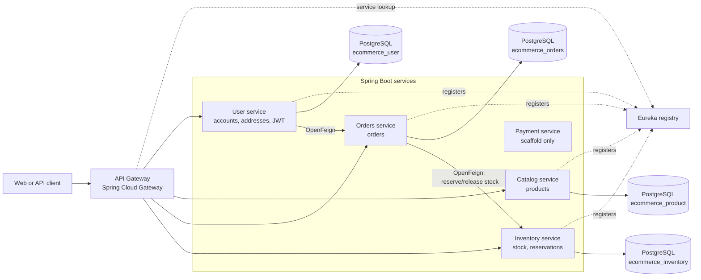

# Commerce Platform

A Java-based e-commerce backend built as a set of Spring Boot services. It explores how a traditional commerce application can be split into independently organized services for customer accounts, product catalog, orders, and inventory, with service discovery and a single API entry point.

> **Project status:** Core account, catalog, order, and inventory flows are implemented. Payment is currently a scaffold, and the checkout workflow is not yet a production-ready distributed transaction.

## What this project does

The project provides REST APIs for customer registration and login, profile and address management, product catalog operations, order creation and lookup, and inventory management. Customers authenticate with a JWT. During checkout, the User service delegates order requests to Orders, which persists the order and asks Inventory to reserve stock.

The goal is to demonstrate service boundaries, API routing, service discovery, token-based security, persistence, and synchronous service-to-service communication in a practical e-commerce domain. The services are separate Maven applications rather than modules in a shared root build.

## Architecture



Each business service owns its persistence boundary. Eureka provides service discovery for load-balanced gateway routes and Feign calls. The gateway is configured on port `8080`; Payment also defaults to `8080`, so run Payment on a different port if you want to run both at once.

### Checkout request flow

1. A customer registers at `POST /api/users` and logs in at `POST /api/auth/login`.
2. User returns a signed bearer JWT. Protected services validate the token independently.
3. The client submits an order through the User order routes or directly to Orders.
4. User forwards the request and bearer token to Orders through Eureka and OpenFeign.
5. Orders derives the customer identity from the token, saves the order, then calls Inventory to reserve stock.
6. Inventory stores reservations and updates stock transactionally.

The current checkout does **not** call Catalog to verify product prices, and Payment is not part of the checkout flow. The order and inventory operations do not share an atomic transaction; durable saga orchestration and reconciliation are future work.

## Services

| Service | Port | Responsibility | Current state |
|---|---:|---|---|
| `api-gateway` | 8080 | Routes external HTTP requests to services discovered by Eureka. | Routes are configured for user/auth, catalog, orders, and inventory APIs. |
| `eureka` | 8761 | Service registry and discovery. | Eureka Server. |
| `user` | 8082 | Registration, login/JWT issuance, profiles, addresses, and order facade. | Implemented; calls Orders using OpenFeign. |
| `orders` | 8083 | Create and retrieve customer orders. | Implemented; requests stock reservations from Inventory. |
| `inventory` | 8084 | Stock lookup/updates, order reservations, and reservation release. | Implemented. |
| `catalog` | 8085 | Product listing and product CRUD. | Implemented. |
| `payment` | 8080 by default | Future payment processing. | Bootstrap only; no payment API or checkout integration yet. |

The API Gateway currently does not include a route for the User address endpoints (`/api/addresses/**`). Services can also be called directly on their local ports during development.

## Technology stack

| Area | Technologies |
|---|---|
| Language/runtime | Java 21 |
| Application framework | Spring Boot 4.1.1 for business services and Eureka; Spring Boot 4.1.2 for the API Gateway |
| Service communication | Spring Cloud OpenFeign for synchronous HTTP clients |
| Gateway and discovery | Spring Cloud Gateway (WebFlux), Netflix Eureka |
| REST APIs | Spring MVC |
| Persistence | Spring Data JPA, Hibernate, PostgreSQL JDBC driver |
| Security | Spring Security, OAuth 2.0 Resource Server, JWT (HS256), BCrypt password hashing |
| Build | Maven, with a Maven Wrapper in each service |
| Testing | Spring Boot test starters, JUnit, and Reactor test support for the Gateway |
| Boilerplate | Lombok |

The business services and Eureka import Spring Cloud BOM `2025.1.3`; the Gateway imports `2025.1.4`. There is no frontend application, message broker, Docker setup, or root-level Maven aggregator in this repository.

## Repository layout

```text
api-gateway/   Gateway routes and Eureka client
catalog/       Product REST API and persistence
eureka/        Service registry
inventory/     Stock and reservation APIs
orders/        Order APIs and Inventory Feign client
payment/       Payment application scaffold
user/          Customer, address, authentication, and Orders Feign client
AUTHENTICATION.md       Authentication and authorization details
MICROSERVICE-ROADMAP.md Current-state assessment and future work
```

## Getting started

### Prerequisites

- JDK 21
- PostgreSQL
- The configured databases: `ecommerce_user`, `ecommerce_product`, `ecommerce_orders`, and `ecommerce_inventory`

Some services currently store local database credentials and the shared development JWT signing key in their `src/main/resources/application.properties`. These values are still tracked source files; `.gitignore` does not hide them. Replace them with environment-based configuration before publishing, and rotate any value that has been used outside a disposable local environment. Never reuse development values in production.

### Run the services

Open a terminal per service. Start Eureka first, then the services that use it, and start the Gateway after the registry and downstream services are available:

```powershell
cd eureka
.\mvnw.cmd spring-boot:run
```

```powershell
cd user
.\mvnw.cmd spring-boot:run
```

```powershell
cd catalog
.\mvnw.cmd spring-boot:run
```

```powershell
cd inventory
.\mvnw.cmd spring-boot:run
```

```powershell
cd orders
.\mvnw.cmd spring-boot:run
```

```powershell
cd api-gateway
.\mvnw.cmd spring-boot:run
```

Run a module's tests from that module's directory:

```powershell
.\mvnw.cmd test
```

Each service is an independent Maven project, so build or test modules individually. Payment is optional and currently only starts its scaffold; if started alongside the Gateway, override one of their ports to avoid the default port conflict.

## API overview

| Service | Example endpoints |
|---|---|
| User | `POST /api/users`, `POST /api/auth/login`, `/api/addresses/**`, `/api/users/{userId}/orders/**` |
| Catalog | `/api/products` |
| Orders | `POST /orders`, `GET /orders`, `GET /orders/{id}` |
| Inventory | `/inventory/{productId}`, `/reservations`, `/reservations/order/{orderId}` |

See the controllers in each service for the full methods and request/response shapes. For JWT claims, token forwarding, and service-specific access rules, see [AUTHENTICATION.md](./AUTHENTICATION.md).

## Known gaps and next steps

- Integrate Catalog into checkout so Orders uses authoritative product data and prices.
- Implement payment APIs and connect payment authorization/capture to checkout.
- Add durable order-state orchestration, idempotent retry handling, and inventory reconciliation.
- Add role-based authorization for administrative product and stock operations.
- Externalize credentials and JWT keys; use database migrations instead of relying on Hibernate schema updates.
- Add API contract documentation, observability, and repeatable local infrastructure (for example, PostgreSQL and services via Docker Compose).

## Before publishing on GitHub

- Replace the local database credentials and JWT signing keys in tracked service configuration; `.gitignore` does not hide values in `application.properties`. Rotate any values that have ever been used outside a disposable local environment.
- Confirm generated build output, JVM crash dumps, logs, and local environment files are not staged. The root `.gitignore` excludes common generated output and local secrets.
- Add a `LICENSE` file if you want others to have clear permission to use, modify, and redistribute the project.
- Review [AUTHENTICATION.md](./AUTHENTICATION.md) and [MICROSERVICE-ROADMAP.md](./MICROSERVICE-ROADMAP.md) for security and implementation limitations before describing the project as production-ready.
# Springboot-ecoms

